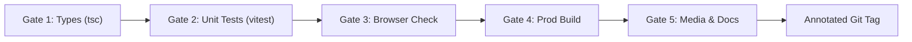

# Release Planning & Versioning Playbook

This skill defines the end-to-end process for planning, verifying, tagging, and publishing releases of Tactical Board Next.

---

## 1. Versioning Standards (SemVer 2.0)

All versions follow the standard semantic versioning format: `vMAJOR.MINOR.PATCH` (e.g. `v1.0.0`, `v1.1.0`).

### When to Bump:
- **`MAJOR` (e.g., `v1.0.0` -> `v2.0.0`):**
  - Breaking changes to the tactical scheme serialization format (`#scheme=` or `tactical-board:collections:v1`).
  - Major architectural rewrite of the canvas rendering engine or store.
  - Incompatible UI redesign or breaking database/storage migration.
- **`MINOR` (e.g., `v1.0.0` -> `v1.1.0`):**
  - New tactical tools (new arrow styles, curved lines, block headers).
  - New pitch divisions or tactical overlays (e.g., FIFA zones, *Juego de Posición* grids).
  - New export features (MP4, GIF, PDF, SVG).
  - New squad formats or equipment items.
- **`PATCH` (e.g., `v1.0.0` -> `v1.0.1`):**
  - Bug fixes (e.g. zoom scale linearity, export edge cases, dragging hitboxes).
  - Visual styling polish, label fixes, performance optimizations.
  - CI/CD workflow updates, documentation improvements.

---

## 2. Pre-Release Quality Gates (Mandatory Checklist)

Before tagging and pushing any release, all five quality gates must pass:



### Gate 1: TypeScript Type Integrity
```powershell
npx tsc --noEmit -p tsconfig.app.json
```
- Must complete with **0 errors**.

### Gate 2: Unit Test Suite
```powershell
npm test -- --watch=false
```
- All test suites must pass (10/10 tests).
- Verifies frame sanitization, board storage serialization, pitch divisions coordinate math, and store signal contracts.

### Gate 3: Visual & Interactive Sanity Check
- Verify the following in the browser (or via browser subagent):
  1. Pitch renders with selected grass stripes and goal nets.
  2. Tokens can be dragged; player numbers and labels remain upright.
  3. Tactical divisions toggle cleanly (`Thirds & 5 Channels`, `18 Zones`, `20 Zones`, sub-zones).
  4. Timeline animation plays forward and pauses without frame drift.
  5. MP4/GIF export modal opens, encodes, and prompts download.

### Gate 4: Production Build & SPA Fallback
```powershell
npm run build:gh-pages
```
- Must succeed with **0 build warnings** (bundle budgets within defined limits).
- Verifies that `dist/tactical-board-next/browser/index.html` and `404.html` are created.

### Gate 5: Media & Documentation Sync
- If UI features or toolbars were changed:
  - Capture updated screenshot (`docs/board-*.png`) or animation (`docs/*.gif`).
  - Update `README.md` feature gallery and release history table.
  - Ensure the Git commit author is set to `Ahmed Mohamed <engahmed.mostafa@yahoo.com>`.

---

## 3. Step-by-Step Release Procedure

### Step 1: Update Release History in `README.md`
Add the new version row to the Release History table in `README.md`:
```markdown
| `v1.1.0` | `2026-11-20` | Full FIFA Pitch Divisions & Juego de Posición Analyzer | `feat(divisions): ...` |
```

### Step 2: Commit All Release Changes
```powershell
git add .
git commit -m "docs: update release history and finalize v1.1.0"
```

### Step 3: Create an Annotated Git Tag
Always create **annotated** tags with a descriptive release message (never lightweight tags):
```powershell
git tag -a v1.1.0 -m "Release v1.1.0: Full FIFA pitch divisions, positional play analysis, and production deployment"
```

### Step 4: Push to Origin
Push the commit and the new tag simultaneously:
```powershell
git push origin main --tags
```

### Step 5: Verify Deployment
1. Open `https://github.com/ahmostafa/tactical-board-next/actions`.
2. Watch the `Deploy Tactical Board Next to GitHub Pages` workflow run.
3. Open the production URL `https://ahmostafa.github.io/tactical-board-next/` and verify live operation.
4. Check GoatCounter analytics dashboard (`https://ammohamed.goatcounter.com`) to confirm live telemetry is recording.

---

## 4. Git Versioning Reference (Tagging & Branching Commands)

### Creating Annotated Tags
```bash
# Tag current HEAD commit:
git tag -a v1.0.1 -m "Release v1.0.1: production deployment and resilience"

# Tag a past commit retroactively:
git tag -a v0.4.0 898ee6b -m "v0.4.0: empty pitch mode and training equipment"
```

### Inspecting Tags
```bash
# List all tags:
git tag -l

# List tags with release annotations:
git tag -n

# Inspect full tag details (tagger, date, commit):
git show v1.0.1
```

### Pushing Tags to Remote
```bash
# Push all local tags:
git push origin --tags

# Push a single tag:
git push origin v1.0.1
```

### Inspecting or Branching from a Version Tag
```bash
# Detached HEAD read-only inspection:
git checkout v0.4.0

# Branch off a tag for maintenance or bug backporting:
git checkout -b maintenance/v0.4-patch v0.4.0
```

### Standard GitHub Flow Branching
1. `main`: Permanent production branch. Always clean, tested, and deployable.
2. `feat/<name>` or `fix/<name>`: Feature/fix branches.
   ```bash
   git checkout -b feat/new-feature main
   # make changes, run tests
   git checkout main
   git merge feat/new-feature
   git tag -a v1.1.0 -m "feat: description of release"
   git push origin main --tags
   git branch -d feat/new-feature
   ```

---

## 5. Hotfix Procedure

If an urgent bug is discovered in production:
1. Create a hotfix branch from `main`:
   ```powershell
   git checkout -b fix/issue-name
   ```
2. Apply the fix and verify against all 5 quality gates.
3. Merge back into `main`:
   ```powershell
   git checkout main
   git merge fix/issue-name
   ```
4. Bump patch version (e.g. `v1.1.1`):
   ```powershell
   git tag -a v1.1.1 -m "Fix: resolve issue with ..."
   git push origin main --tags
   ```
5. GitHub Actions automatically deploys the patch live within 60 seconds.
