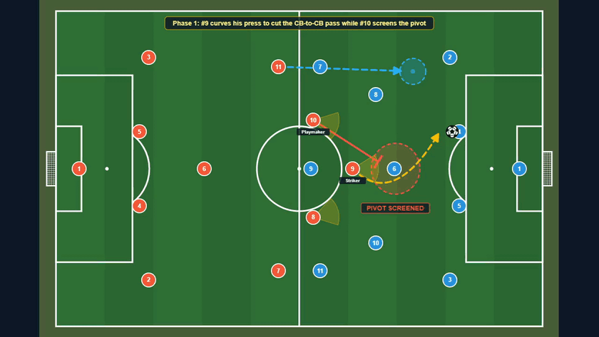
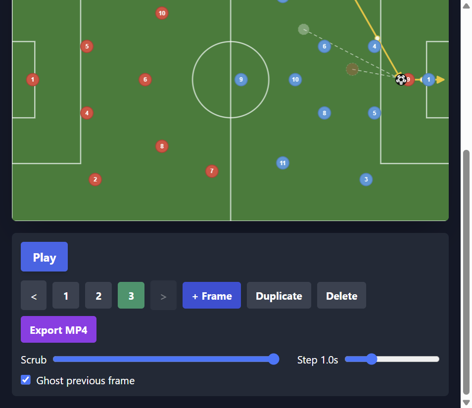
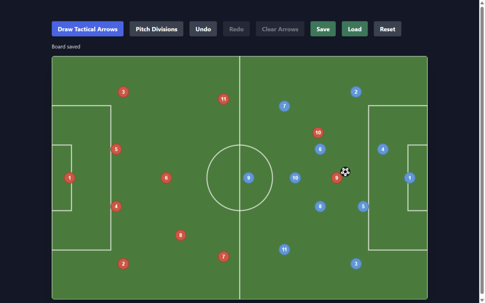

# Tactical Board Next

A modern, responsive, browser-based football tactical board for match analysis and coaching presentations. Drag players and the ball at 60fps, sketch curved tactical arrows in four distinct styles, overlay analytical pitch divisions, animate multi-step plays on a keyframe timeline, and export HD `.mp4` videos directly in the browser.



> **Exported Video Demo:** [Download / Watch `docs/tactical-board-demo.mp4`](docs/tactical-board-demo.mp4) *(1280×720 HD, 30 fps, H.264 Main Profile + AAC, exported directly from the browser via FFmpeg.wasm)*

---

## Features

### 1. Full 11v11 Pitch & Classic Match Ball
- **Proportional 105×68 m pitch:** Complete markings including halfway line, center circle, penalty areas, 6-yard goal boxes, penalty spots, penalty arcs, corner arcs, and goals.
- **Complete starting formations:** **4-3-3** (Red) vs **4-2-3-1** (Blue), plus a classic black-and-white pentagon match ball.
- **Boundary-clamped 60fps drag & drop:** Every player token and the ball can be dragged smoothly with mouse or touch and is automatically kept inside the pitch boundaries.

---

### 2. Tactical Arrows (`Pass | Run | Dribble | Target Zone`) & Curved Paths
Click **Draw Tactical Arrows** — or click any arrow style button directly (`Pass`, `Run`, `Dribble`, `Target Zone`) — to enter drawing mode and sketch tactical movements directly from the center of any player token on the first click:

| Style | Visual | Coaching Purpose |
| :--- | :--- | :--- |
| **Pass** | Solid yellow arrow | Ball passes, switches of play, crosses, and shots on goal |
| **Run** | Dashed yellow arrow | Off-the-ball player runs, overlaps, underlaps, and pressing triggers |
| **Dribble** | Wavy sinusoidal arrow | Ball-carrier dribbles and driving into open space |
| **Target Zone** | Dashed arrow pointing into a highlighted circular zone | Instructing a player to move into or attack a specific empty space |

- **Curved trajectories:** Every drawn arrow exposes a draggable **midpoint control handle** (white circle with amber ring) so you can bend any pass, run, dribble, or target-zone movement into a smooth quadratic Bézier curve.
- **Store-backed history:** Arrows belong to the active keyframe and participate in **Undo**, **Redo**, **Clear Arrows**, **Duplicate Frame**, **Save**, and **Load**.


---

### 3. Pitch Divisions & Analytical Zones Overlay
Toggle **Pitch Divisions** to overlay standard coaching analysis zones above the grass and beneath the players:

- **Three horizontal thirds:** *Defensive third*, *Middle third*, and *Final third*
- **Five vertical channels:**
  - *Left wing*
  - *Left half-space* (highlighted amber tint)
  - *Centre* (aligned to the width of the 6-yard box)
  - *Right half-space* (highlighted amber tint)
  - *Right wing*
- **Highlighted penalty areas:** Subtle analytical tint over both 18-yard boxes.


---

### 4. Keyframe Timeline, Animated Playback, Scrubber & Ghosting
Build multi-phase tactical plays step by step:

- **Keyframe management:**
  - **`+ Frame`** inserts a new step after the current frame, preserving player and ball positions with a clean arrow layer for the next phase.
  - **`Duplicate`** clones the current frame including all of its drawn arrows.
  - **`Delete`** removes the current frame when more than one frame exists.
  - **`< 1 2 3 >` chips & `←` / `→` arrow keys** jump directly to any keyframe.
- **Smooth `Konva.Tween` playback (`Play / Stop`):**
  - Players and the ball glide smoothly between frames with `EaseInOut` interpolation while tactical arrows animate across phases.
  - Adjustable **Step duration slider** (`0.3s` to `3.0s` per transition).
- **Interactive `Scrub` slider:**
  - Drag continuously across the timeline to preview exact interpolated player positions between any two keyframes; release to snap to the nearest frame.
- **Ghost previous frame (`Ghost previous frame` toggle):**
  - Displays faded ghost tokens (`30%` opacity) and dashed movement trails connecting each player's previous-frame position to their current position while editing.


---

### 5. Client-Side MP4 Video Export (`FFmpeg.wasm`)
Click **Export MP4** in the timeline bar to render and download your entire tactical sequence as a standalone `.mp4` video without any backend server:

- **Smooth 30 fps frame synthesis:** Captures an initial hold, interpolates every transition step at 30 fps with `EaseInOut` player motion and arrow transitions, and holds the final frame.
- **Universal Windows / macOS / Mobile compatibility:**
  - Encoded at **1280×720 HD** (`SAR 1:1`, `DAR 16:9`, macroblock-aligned) using **H.264 Main Profile (`libx264`, Level 3.1, `yuv420p`, `BT.709`)** + stereo **AAC** audio track in an `mp42` (`+faststart`) container.
  - Opens out of the box in **Windows 11 Media Player**, **Windows Media Player Legacy**, **QuickTime**, **VLC**, web browsers, and social/messaging platforms.
- **Sample exported video:** [`docs/tactical-board-demo.mp4`](docs/tactical-board-demo.mp4)



---

### 6. Undo / Redo, Keyboard Shortcuts, Save / Load & Reset
- **Per-frame Undo / Redo:** Tracks every player drag, ball move, arrow draw, curve adjustment, clear, and formation reset within each frame.
- **Browser persistence (`Save` / `Load`):** Saves the entire multi-frame timeline, player coordinates, arrow styles, curve control points, and step duration to `localStorage` (`tactical-board:v1`), with backward-compatible validation for single-frame boards.
- **Formation `Reset`:** Restores the current frame to the default 11v11 kickoff setup (undoable).

| Shortcut | Action |
| :--- | :--- |
| `Ctrl + Z` (`Cmd + Z` on Mac) | Undo last action in the current frame |
| `Ctrl + Y` or `Ctrl + Shift + Z` | Redo last undone action in the current frame |
| `←` / `→` | Step to previous / next timeline frame |



---

### 7. Responsive by Design
A `ResizeObserver` dynamically scales the Konva stage to fit its container while keeping all internal coordinates normalized to `1050×680`, ensuring crisp rendering and accurate pointer math across desktop monitors, tablets, and mobile screens.

---

## Tech Stack

- **Angular 19**: Standalone components, Angular Signals, `OnPush` change detection
- **NgRx Signals (`@ngrx/signals`)**: Single source of truth for timeline frames, entity positions, arrow styles/curves, and per-frame undo/redo stacks
- **Konva.js**: 2D HTML5 Canvas engine running outside the Angular zone (`NgZone.runOutsideAngular`) for 60fps interaction
- **FFmpeg.wasm (`@ffmpeg/core`)**: In-browser WebAssembly video encoding (`libx264` + `aac`)
- **Tailwind CSS v3**: Dark tactical UI styling

## Architecture Notes

- `BoardStore` (`src/app/pitch-board/board.store.ts`) is the single source of truth. An Angular `effect()` synchronizes Konva nodes from store state whenever the active frame, entities, or arrows change.
- Konva uses five dedicated layers for clean separation of concerns:
  1. `pitchLayer` — grass, pitch lines, penalty boxes, and goals
  2. `divisionsLayer` — analytical thirds, channels, and half-space highlights
  3. `ghostLayer` — previous-frame faded tokens and dashed movement trails
  4. `drawingLayer` — `Pass`, `Run`, `Dribble`, and `Target Zone` arrows + curve handles
  5. `entityLayer` — draggable red/blue player tokens and the classic football

## Getting Started

```bash
npm install
ng serve
```

Then open `http://localhost:4200/` in your browser.

## Roadmap

- [x] Proportional 11v11 pitch, classic football, and boundary-clamped 60fps drag & drop
- [x] Drawing mode for tactical arrows
- [x] Undo / redo / clear, keyboard shortcuts (`Ctrl+Z` / `Ctrl+Y`), reset, and `localStorage` save & load
- [x] Pitch divisions overlay (thirds, 5 vertical channels, highlighted half-spaces & penalty areas)
- [x] Keyframe timeline engine: multi-frame playback, scrub slider, step duration control, and ghost trails
- [x] Client-side 720p H.264 MP4 video export with FFmpeg.wasm
- [x] Four tactical arrow styles (`Pass`, `Run`, `Dribble`, `Target Zone`) and interactive curved arrow handles
- [ ] AI-driven tactical setups via natural language (planned in a dedicated phase)

## Author

Ahmed Mohamed
