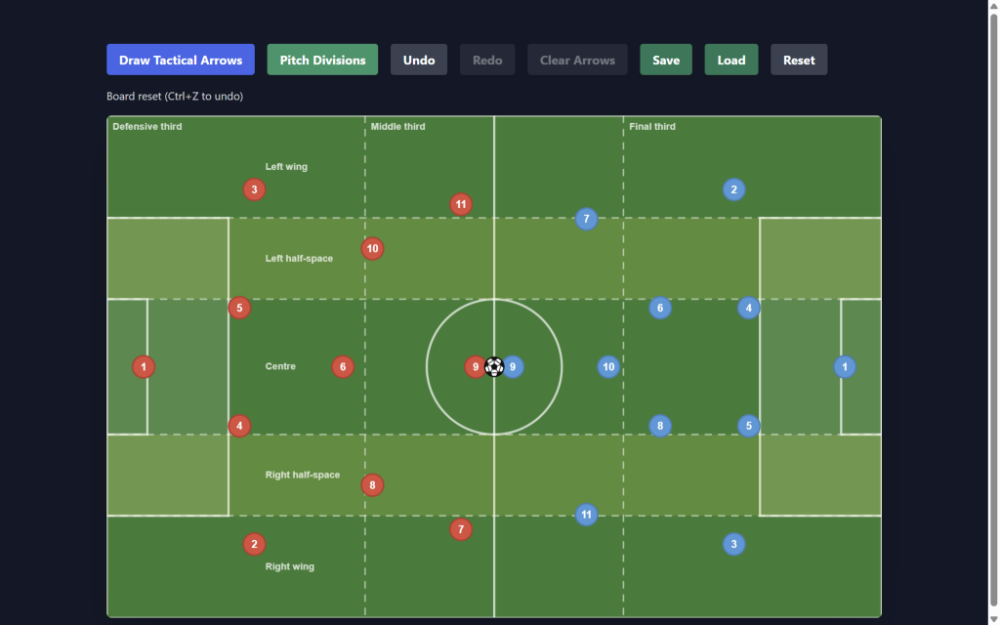

# Tactical Board Next

A modern, responsive, browser-based tactical football board for match analysis. Move players, draw movement and passing arrows, overlay tactical zones, and save your boards, all running smoothly at 60fps.


## Features

### Full 11v11 setup
A 105×68 m pitch with all line markings and a complete 4-3-3 (red) vs 4-2-3-1 (blue) setup, plus a classic black-and-white ball. Every token can be dragged with the mouse or a finger, and is kept inside the pitch lines.

### Tactical arrows
Switch on **Draw Tactical Arrows** to freeze the players and sketch passing or movement lines. Stray taps are ignored, and arrows live in the store, so they take part in undo/redo, save and load.


### Pitch divisions overlay
Toggle **Pitch Divisions** to show the analytical zones:

- Defensive, middle and final thirds
- Five vertical channels: left wing, left half-space, centre, right half-space, right wing
- Highlighted half-spaces and both penalty areas

The centre channel matches the width of the 6-yard box, and the half-spaces fill the rest of the penalty-area width.



### Undo, redo, reset and save/load
- **Undo / Redo** for every player move, arrow and clear (also `Ctrl+Z`, `Ctrl+Y` and `Ctrl+Shift+Z`, with `Cmd` on Mac)
- **Clear Arrows** to wipe the drawings
- **Reset** to return to the starting formation (undoable)
- **Save / Load** to keep a board in your browser's local storage; loading validates the data and is undoable too


### Responsive by design
A `ResizeObserver` keeps the Konva stage scaled to its container without losing coordinate accuracy, so the board works on desktop, tablet and phone.

## Tech Stack

- **Angular**: standalone components, signals, OnPush change detection
- **NgRx Signals**: single store for player positions, arrows and undo/redo history
- **Konva.js**: used natively outside the Angular zone for smooth rendering
- **Tailwind CSS v3**

## Architecture Notes

- The store is the single source of truth. An `effect()` syncs the Konva nodes from it, which is what makes undo/redo, load and reset work, and it is the base for the upcoming timeline and AI features.
- Konva has separate layers for the pitch, the divisions overlay, the drawings and the players.

## Getting Started

```bash
npm install
ng serve
```

Then open http://localhost:4200.

## Roadmap

- [x] Pitch, players, drag & drop, responsive canvas
- [x] Drawing mode for tactical arrows
- [x] Undo / redo / clear, keyboard shortcuts, reset, save & load
- [x] Pitch divisions overlay
- [ ] Timeline engine for frame-by-frame animation
- [ ] AI-driven tactical setups via natural language
- [ ] Client-side MP4 export with FFmpeg.wasm

## Author

Ahmed Mohamed
