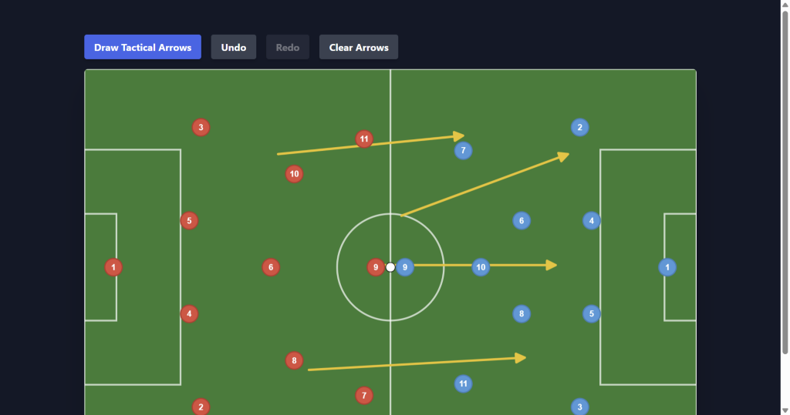

# Tactical Board Next

A modern, responsive, browser-based tactical football board for match analysis.



## Features

- Proportioned 105×68 m pitch with all line markings
- Full 11v11 setup (4-3-3 Home vs 4-2-3-1 Away) plus the ball
- Smooth drag & drop (mouse and touch), constrained to the pitch
- Responsive canvas that keeps coordinates intact on any screen size
- Drawing mode for tactical passing/movement arrows
- Undo / Redo / Clear Arrows
- Store-driven rendering: the Konva scene is synced from the state

## Tech Stack

- Angular (standalone components, signals, OnPush)
- NgRx Signals for state management
- Konva.js, used natively outside the Angular zone for 60fps
- Tailwind CSS v3

## Getting Started

```bash
npm install
ng serve
```

Then open http://localhost:4200.

## Roadmap

- [x] Phase 1: pitch, players, drag & drop, drawing mode
- [x] Undo / redo / clear drawings
- [ ] Pitch divisions overlay (half-spaces, final third, 16-yard grids)
- [ ] Timeline engine for frame-by-frame animation
- [ ] Client-side MP4 export with FFmpeg.wasm
- [ ] AI-driven tactical setups via natural language

## Author

Ahmed Mohamed
