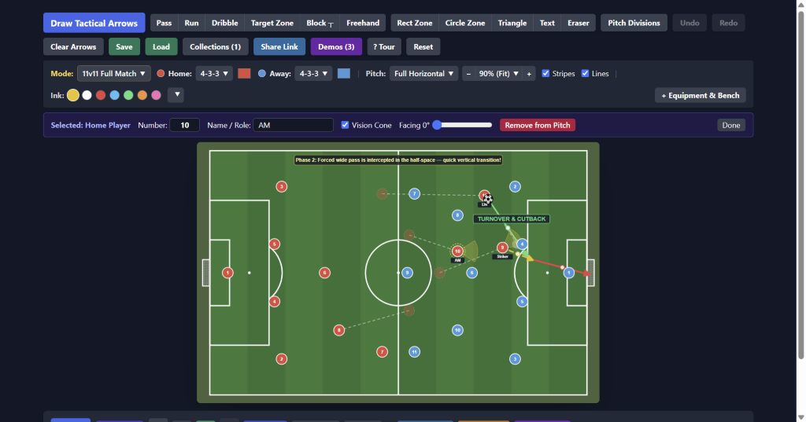

# Tactical Board Next

A modern, responsive, browser-based football tactical board for match analysis, set-piece design, and coaching sessions. Drag players, referees, and training equipment at 60fps, switch instant 11v11 formations, sketch curved tactical arrows in six styles, highlight tactical zones, animate multi-step plays on a keyframe timeline, organize schemes in a Collections Library, and export HD `.mp4` videos, animated `.gif` files, and `2x` `.png` images directly in the browser.


> **Exported HD Video Demos (1280×720, 30 fps, H.264 Main Profile + AAC via FFmpeg.wasm):**
> - **11v11 Match Tactic:** [Download / Watch `docs/tactical-board-demo.mp4`](docs/tactical-board-demo.mp4) *(High Press & Midfield Trap transition)*
> - **Empty Pitch 3v2 Drill & Goal Scored (`⚽ GOAL!`):** [Download / Watch `docs/drill-overload-demo.mp4`](docs/drill-overload-demo.mp4) *(Half-pitch overload drill with cones, mannequin, and goal in the net)*

---

## Features

### 1. Squad Modes (11v11, 9v9, 7v7, 5v5, Empty Pitch), Instant Formations & Multi-View Pitch
- **5 Squad & Drill Modes (`Mode:` selector):** Switch between **`11v11 Full Match`**, **`9v9 Youth / Tactical`**, **`7v7 Small-Sided`**, **`5v5 Futsal / Drill`**, or **`Empty Pitch (Free Build)`** (clears the field so coaches can drag out just 2–3 players, balls, and cones to explain specific drills).
- **7 Built-in 11v11 Formations** for both Home and Away teams (`4-3-3`, `4-2-3-1`, `4-4-2`, `3-5-2`, `3-4-3`, `5-3-2`, `4-1-4-1`) — switch formations at any time while preserving player names, jersey numbers, and vision settings.
- **Custom Team Colors:** Live color pickers for both Home and Away kits.
- **4 Pitch Views & Expanded Zoom (`70%` – `200%`):**
  - `Full Horizontal` (standard 105×68 m view with outer stadium apron and protruding woven goal nets)
  - `Half Pitch (Left)` & `Half Pitch (Right)` (framed from outer goal net to the halfway line for set pieces and pressing traps)
  - `Full Vertical` (coach's touchline / behind-goal perspective with counter-rotated upright player numbers, names, Referee `R`, and cones)
  - **Expanded Zoom (`- / +` & `70%` up to `200%`):** Scale the board from compact `70%` (`90% (Fit)` default) up to `200%` close-up.
  - Toggleable **Mowed Grass Stripes**, **Pitch Lines (Markings)**, penalty spots, penalty arcs, and **Protruding Woven Goal Nets** (dragging the ball inside either goal net triggers a live **`⚽ GOAL!`** celebration banner).
- **Interactive 6-Step Feature Tour (`? Tour`) & Built-In Animated Demos (`Demos (3)`):**
  - Step-by-step interactive onboarding tour with one-click **"Try It"** actions.
  - 3 ready-to-play multi-frame animated coaching presets: **`3v2 Overload Drill & Goal Scored`**, **`High Press & Midfield Trap (11v11)`**, and **`In-Swinging Corner Routine (Set Piece)`**.




---

### 2. Six Tactical Arrow Styles, Zone Shapes, Text & Eraser
Click **Draw Tactical Arrows** or select any drawing tool directly:

| Tool | Visual | Coaching Purpose |
| :--- | :--- | :--- |
| **Pass** | Solid arrow | Ball passes, switches of play, crosses, and shots on goal |
| **Run** | Dashed arrow | Off-the-ball player runs, overlaps, underlaps, and pressing triggers |
| **Dribble** | Wavy sinusoidal arrow | Ball-carrier dribbles and driving into open space |
| **Target Zone** | Dashed arrow + target circle | Instructing a player to attack or occupy a specific space |
| **Block `┬`** | Solid line with perpendicular T-bar | Screening passing lanes, defensive blocks, and pressing walls |
| **Freehand** | Smooth freehand pencil stroke | Custom coaching sketches on the pitch |
| **Rect / Circle / Triangle Zone** | Semi-transparent dashed polygon | Highlighting pressing traps, overload zones, and defensive blocks |
| **Text** | Draggable on-pitch label (`S / M / L`) | Tactical cues and phase labels directly on the grass |
| **Eraser** | Single-click item remover | Click any individual arrow, shape, text label, or equipment item to remove it |

- **7 Drawing Ink Colors & 3 Stroke Weights (`Thin`, `Med`, `Thick`)**
- **Curved trajectories:** Every directional arrow (`Pass`, `Run`, `Dribble`, `Target Zone`, `Block ┬`) exposes a draggable **midpoint control handle** for smooth quadratic Bézier curves.
- **Per-Frame Coaching Notes:** Add a coaching subtitle to each step (rendered as a clean banner at the top of the pitch during playback and export).


---

### 3. Empty Pitch Drill Builder, Drag & Drop Palette & Goal Scored Net (`⚽ GOAL!`)
Expand **`+ Equipment & Bench`** (or switch `Mode:` to **`Empty Pitch (Free Build)`**) to drag and drop or click-spawn tokens and training gear directly onto exact pitch coordinates:
- **Draggable Bench & Match Tokens:** `+ Home Player`, `+ Home GK`, `+ Away Player`, `+ Away GK`, `+ Referee`, `+ Ball` (multi-ball drills supported)
- **9 Draggable Vector Training Equipment Items:**
  - `Cone`, `Marker Disc`, `Hurdle`, `Agility Ladder`, `Slalom Pole`, `Mannequin Wall`, `Training Ring`, rotatable `Mini-Goal`, and `Goal Net (Scored!)`
- **Live Goal Scored Detection (`⚽ GOAL!`):** Dragging the match ball inside the left or right protruding woven goal net highlights the net in gold and renders a **`⚽ GOAL!`** celebration badge during editing, playback, and MP4/GIF export.
- **Selected Token Inspector Bar:** Click any player or equipment token in Move mode to customize:
  - **Jersey Number** (`1–99`)
  - **Player Name / Role Tag** (rendered in a pill badge beneath the player token)
  - **Directional Vision Cone (`65°` FOV)** + **Facing Angle Slider (`0°–360°`)** to visualize body orientation and scanning angles
  - **Equipment Rotation (`+45°`)** and **Remove from Pitch**


> **Exported Drill Video:** [Download / Watch `docs/drill-overload-demo.mp4`](docs/drill-overload-demo.mp4) *(Half-pitch 3v2 overload drill ending with a goal inside the protruding woven net)*

---

### 4. Full Vertical View & Multi-System Pitch Tactical Divisions
- **Full Vertical View (`Pitch: Full Vertical`):** Rotates the stage to a coach's behind-the-goal / touchline perspective while automatically counter-rotating player jersey numbers (`1–11`), Referee `R`, player nameplates, on-pitch text labels, and upright equipment (`Cone`, `Mannequin Wall`, `Hurdle`, `Slalom Pole`, `Goal Net`) so nothing appears sideways.
- **Pitch Tactical Divisions & Coordinate Systems (`Pitch Divisions` / `Grid:`):** Normalized to a FIFA `105m × 68m` pitch (`1m = 10px`) with smart show/hide layering:
  - **Mutually Exclusive Primary Grids (Pick 1):**
    1. **`3 Thirds Only`:** Horizontal *Defensive (`0–35m`)*, *Middle (`35–70m`)*, and *Final (`70–105m`)* thirds plus subtle 18-yard box tint.
    2. **`5 Channels Only`:** The 5 FIFA marking-anchored lanes (*Left Flank*, *Left Half-Space*, *Central Corridor*, *Right Half-Space*, *Right Flank*).
    3. **`Thirds + 5 Channels`:** Combined horizontal thirds + 5 vertical lanes + 18-yard box tint.
    4. **`18-Zone Grid (1–18)`:** 3 equal lanes (`22.67m`) × 6 horizontal strips (`17.5m`), sequentially numbered `Zone 1` to `Zone 18` (`Zone 14` highlighted as the Assist Zone, `Zone 17` as the Penalty Box).
    5. **`20-Zone Juego de Posición (`B-LF` .. `F-RF`)`:** 5 marking-anchored channels × 4 functional tiers (*Build-Up*, *Progression*, *Creation* with `C-LHS`/`C-RHS` Prime Pockets, and *Finishing*).
  - **Independent Tactical Sub-Zone Toggles & Spacing Rules (Layer on Any Grid or Clean Pitch):**
    - **`Zone 14 (Assist Zone)`** (`X: 70–88.5m, Y: 22.67–45.33m`)
    - **`Golden Zone`** (`X: 94–105m, Y: 24.84–43.16m` — 6-yard width out to the penalty spot)
    - **`Half-Space Pockets`** (`X: 52.5–88.5m` inside Left & Right Half-Spaces)
    - **`Byline Cutback Zones`** (`X: 88.5–105m` wide penalty-box channels)
    - **`⇄ Both Halves`:** Mirrors active sub-zones onto both defensive and attacking halves.
    - **`⚡ Spacing Rules`:** Live *Juego de Posición* spacing rule checker that highlights any vertical channel with `>2` outfield players or horizontal tier with `>3` outfield players.
  - **Live Token Coordinate Badge:** Clicking any player or ball displays its real-time FIFA meter coordinates (`e.g. 78.0m × 34.0m`), `Zone 1..18`, `20-Zone` code (`C-C`), and active specialized sub-zone inside the Token Inspector.


---

### 5. Keyframe Timeline, Step Playback, Scrubber & Ghosting
Build multi-phase tactical plays step by step:

- **Keyframe management:** `+ Frame`, `Duplicate`, `Delete`, `< 1 2 3 >` frame chips, and `←` / `→` keyboard navigation.
- **Smooth `Konva.Tween` playback:**
  - **`Play / Stop`:** Plays the full multi-step sequence with optional **`Loop`** mode.
  - **`Play Step`:** Animates just the single transition from the current frame to the next frame and pauses for step-by-step coaching walk-throughs.
  - Adjustable **Step duration slider** (`0.3s` to `3.0s` per transition).
- **Interactive `Scrub` slider** & **Ghost previous frame** (`30%` opacity tokens + dashed movement trails).


---

### 6. Client-Side PNG, Animated GIF & HD MP4 Export (`FFmpeg.wasm`)
Export your tactical board or animation without any server or watermark:

- **`Export PNG`:** Instant `2x` high-DPI (`2100×1360`) snapshot of the current frame.
- **`Export GIF`:** Synthesizes the full animated timeline and encodes a two-pass palette-optimized looping `.gif` (`840px` wide) directly in the browser via `FFmpeg.wasm`.
- **`Export MP4`:** Renders the full sequence at 30 fps and encodes a universally compatible **1280×720 HD** `.mp4` (`H.264 Main Profile Level 3.1`, `yuv420p`, `BT.709`, stereo `AAC` audio, `mp42 +faststart`) that plays natively in **Windows 11 Media Player**, **QuickTime**, **VLC**, and web browsers.


---

### 7. Collections Library, JSON Import/Export & Shareable URLs
- **Collections Library (`Collections` drawer):** Save up to 1,000 named tactical schemes in `localStorage` categorized as `Match Tactic`, `Set Piece`, or `Training Drill`, and load or delete them with one click.
- **Portable `.json` Backup:** Export your current board to a `.json` file or import any saved `.json` tactic file.
- **Zero-Backend Shareable Links (`Share Link`):** Encodes the entire multi-frame board state into `#scheme=<base64url>` in the URL and copies the link to the clipboard so opening the URL immediately restores the full animation.

| Shortcut | Action |
| :--- | :--- |
| `Ctrl + Z` (`Cmd + Z` on Mac) | Undo last action in the current frame |
| `Ctrl + Y` or `Ctrl + Shift + Z` | Redo last undone action in the current frame |
| `←` / `→` | Step to previous / next timeline frame |

---

## Tech Stack

- **Angular 22**: Standalone components, Angular Signals, `OnPush` change detection
- **NgRx Signals (`@ngrx/signals`)**: Single source of truth for timeline frames, formations, entity metadata, arrows, shapes, texts, and per-frame undo/redo stacks
- **Konva.js**: 2D HTML5 Canvas engine running outside the Angular zone (`NgZone.runOutsideAngular`) for 60fps interaction
- **FFmpeg.wasm (`@ffmpeg/core`)**: In-browser WebAssembly video and GIF encoding (`libx264`, `aac`, `palettegen`/`paletteuse`)
- **Tailwind CSS v3**: Dark tactical UI styling

## Architecture Notes

The codebase follows a pragmatic, human-readable Angular feature structure under `src/app/pitch-board/`:

- **`models/tactical-board.models.ts`:** Domain interfaces (`TacticalEntity`, `TacticalArrow`, `TacticalShape`, `TacticalText`, `Snapshot`), pitch dimensions (`1050×680`, goal mouth, stadium apron), color presets, zoom levels, and SVG cursors.
- **`board.store.ts` & `state/board-sanitizer.ts`:** `BoardStore` (`@ngrx/signals`) is the single source of truth for timeline frames, squad modes, formations, team colors, and per-frame undo/redo stacks, backed by `sanitizeFrame()` for safe JSON/URL import.
- **`canvas/` (`pitch-renderer.ts`, `arrow-renderer.ts`, `entity-renderer.ts`, plus `equipment-renderer.ts`):** Pure, modular Konva rendering functions and geometry math (`computeArrowPath`, `computeTBarPoints`) separated across six Konva layers:
  1. `pitchLayer` — outer stadium apron, mowed grass stripes, pitch markings, penalty boxes/arcs, and protruding woven 3D goal nets
  2. `divisionsLayer` — analytical thirds, channels, and half-space highlights
  3. `shapesLayer` — tactical rectangle, ellipse, and triangle zone overlays
  4. `ghostLayer` — previous-frame faded tokens and dashed movement trails
  5. `drawingLayer` — `Pass`, `Run`, `Dribble`, `Target Zone`, `Block ┬`, and `Freehand` arrows + curve handles + on-pitch text labels + `"⚽ GOAL!"` celebration banner
  6. `entityLayer` — draggable player tokens (with upright numbers, nameplates & vision cones), referees, match balls, and 9 vector training equipment types
- **`services/board-export.service.ts`:** Injectable Angular service encapsulating `2x` PNG, animated GIF, and `1280×720` H.264 MP4 video encoding via `FFmpeg.wasm`.
- **`pitch-board.component.ts` + `.html` & `components/`:** Clean orchestrator paired with focused standalone sub-components (`TourDemosPanelComponent`, `EquipmentPaletteComponent`, `TokenInspectorComponent`, `CollectionsDrawerComponent`, and `TimelineBarComponent`).

## Getting Started

```bash
npm install
ng serve
```

Then open `http://localhost:4200/` in your browser.

## Development, Testing & Agent Skills

The repository ships project skills in [`.agents/skills/`](.agents/skills) that document how the project is built, tested, analysed and documented:

| Skill | Covers |
| :--- | :--- |
| [`tactical-board-dev`](.agents/skills/tactical-board-dev/SKILL.md) | Architecture (store, Konva layers), conventions, adding arrow styles, git rules, definition of done |
| [`tactical-board-testing`](.agents/skills/tactical-board-testing/SKILL.md) | Type check, vitest, browser verification, regression checklist |
| [`tactical-board-analysis`](.agents/skills/tactical-board-analysis/SKILL.md) | Reproduce-first debugging, log of past root causes, next-feature analysis |
| [`readme-media`](.agents/skills/readme-media/SKILL.md) | Screenshots, GIF generation, demo MP4, README gallery |
| [`mp4-export-compat`](.agents/skills/mp4-export-compat/SKILL.md) | Encode settings that play on Windows 11, `0xc10100be` and 0 B fixes |

### Checks before a commit

```bash
npx tsc --noEmit -p tsconfig.app.json
npm test
```

## Roadmap

- [x] Proportional 11v11 pitch, outer stadium apron, protruding woven goal nets, classic football, and boundary-clamped 60fps drag & drop
- [x] 5 squad & drill modes (`11v11`, `9v9`, `7v7`, `5v5`, `Empty Pitch`), 7 instant 11v11 formations (`4-3-3`, `4-2-3-1`, `4-4-2`, `3-5-2`, `3-4-3`, `5-3-2`, `4-1-4-1`), custom team colors, 4 pitch views (`Full`, `Half Left`, `Half Right`, `Vertical` with upright numbers/cones), and board zoom from `70%` to `200%`
- [x] Mowed grass stripes, protruding woven goal nets with live `⚽ GOAL!` detection, and 18-zone analytical pitch divisions overlay
- [x] 6 tactical arrow styles (`Pass`, `Run`, `Dribble`, `Target Zone`, `Block ┬`, `Freehand`), curved Bézier handles, 7 ink colors, 3 stroke weights, and contextual SVG mouse cursors (`Eraser`, `Pencil`, `Crosshair`, `Grab`)
- [x] Tactical zone shapes (`Rect`, `Circle`, `Triangle`), draggable on-pitch text labels, per-frame coaching notes, and single-click item eraser
- [x] Drag-and-drop bench & training equipment palette (`Cone`, `Marker Disc`, `Hurdle`, `Agility Ladder`, `Slalom Pole`, `Mannequin Wall`, `Training Ring`, `Mini-Goal`, `Goal Net (Scored!)`, `Referee`, Goalkeepers, extra players & balls)
- [x] Player token inspector: custom jersey numbers, name/role badges, and directional `65°` vision cones
- [x] Interactive 6-step onboarding feature tour (`? Tour`) and 3 built-in multi-frame animated demo tactics (`Demos (3)`)
- [x] Keyframe timeline engine: `Play`, `Play Step`, `Loop`, scrub slider, step duration control, and ghost trails
- [x] Client-side `2x` PNG, animated GIF, and 720p H.264 MP4 video export with FFmpeg.wasm
- [x] Collections Library (up to 1,000 schemes), `.json` import/export, and `#scheme=` shareable URLs
- [ ] AI-driven tactical setups via natural language (planned in a dedicated phase)

## Release Milestones & Version History

This repository follows [Semantic Versioning (SemVer)](https://semver.org/) (`vMAJOR.MINOR.PATCH`). Every major milestone is permanently tagged in Git and published to [GitHub Releases](https://github.com/ahmostafa/tactical-board-next/tags):

| Version | Milestone Commit | Description & Key Features |
| :--- | :--- | :--- |
| **`v1.0.0`** | `73d13af` | **Official v1.0.0 Release**: Full FIFA `105m × 68m` pitch divisions (3 Thirds, 5 Channels, 18-Zone, 20-Zone *Juego de Posición*), specialized sub-zones (Zone 14, Golden Zone, Pockets, Cutbacks), live token coordinate badge, live *Juego de Posición* spacing rules checker, and smooth linear zoom scaling. |
| **`v0.5.0`** | `f611977` | **Pragmatic Angular 22 Architecture**: Modularized into domain models (`models/`), state sanitizer (`state/`), pure Konva renderers (`canvas/pitch-renderer`, `arrow-renderer`, `entity-renderer`), injectable `BoardExportService` (`services/`), and 5 standalone UI sub-components (`components/`). |
| **`v0.4.0`** | `898ee6b` | **Empty Pitch & Drill Suite**: Empty Pitch Free Build mode, squad presets (`11v11`–`5v5`), drag-and-drop palette, 9 training equipment types, 6-step interactive tour (`? Tour`), and 3 animated demo tactics. |
| **`v0.3.0`** | `e10efa3` | **Realistic Pitch Geometry**: Outer boundary stadium apron, protruding 3D woven goal nets, 7 instant formations, custom team colors, and Collections library. |
| **`v0.2.0`** | `5fab12d` | **Timeline & Video Export**: Multi-step keyframe timeline, `Konva.Tween` playback, scrubber, ghost trails, and client-side H.264 MP4 & GIF export via `FFmpeg.wasm`. |
| **`v0.1.0`** | `436147b` | **Core Interactive Board**: Proportional 11v11 pitch, 22 players, classic black/white football, undo/redo, and initial analytical divisions overlay. |

---

## Git Versioning & Release Guide (How It Works)

Git tags provide permanent, unchangeable bookmarks to specific commits in your repository's history, allowing you to track releases, download snapshots, or roll back to any past version.

### 1. Semantic Versioning Format (`vMAJOR.MINOR.PATCH`)
- **`MAJOR` (e.g. `v1.0.0` → `v2.0.0`)**: Large milestone releases or architectural overhauls.
- **`MINOR` (e.g. `v1.0.0` → `v1.1.0`)**: New backward-compatible features (e.g., adding a new arrow style or drill tool).
- **`PATCH` (e.g. `v1.0.0` → `v1.0.1`)**: Backward-compatible bug fixes or visual adjustments (e.g., smoothing zoom steps).

### 2. Creating Annotated Tags
An **annotated tag** stores the tagger name, email, date, and a descriptive release message:

```bash
# Tag the current HEAD commit:
git tag -a v1.0.0 -m "v1.0.0 - Official v1.0 release with tactical divisions and spacing rules"

# Tag a past commit retroactively by providing its commit hash:
git tag -a v0.4.0 898ee6b -m "v0.4.0 - Empty pitch mode and drag-and-drop equipment suite"
```

### 3. Inspecting Tags
```bash
# List all tags:
git tag -l

# List tags with their annotation messages:
git tag -n

# View full details (tagger, date, commit, and diff summary) for a specific tag:
git show v1.0.0
```

### 4. Pushing Tags to GitHub
Tags are not pushed by standard `git push origin main`. They must be pushed explicitly:

```bash
# Push all local tags to the remote repository:
git push origin --tags

# Push a single tag to the remote repository:
git push origin v1.0.0
```

### 5. Checking Out or Branching from a Version Tag
Tags are read-only references. To test or work on an older version:

```bash
# Switch to a tagged version in detached HEAD state (read-only inspection):
git checkout v0.4.0

# Create a new branch starting from a specific version (e.g. for maintenance or backporting a fix):
git checkout -b maintenance/v0.4-patch v0.4.0
```

### 6. Standard Branching Workflow Going Forward (GitHub Flow)
1. **`main`**: Permanent production branch. Always stable, build-tested, and tagged.
2. **`feat/<feature-name>`** or **`fix/<bug-name>`**: Create a branch for any new feature or fix:
   ```bash
   git checkout -b feat/pdf-export main
   ```
3. Make commits, verify with `npx tsc --noEmit` and `npm test`.
4. Merge into `main` and tag the new version:
   ```bash
   git checkout main
   git merge feat/pdf-export
   git tag -a v1.1.0 -m "feat: add vector PDF export for tactical schemes"
   git push origin main --tags
   git branch -d feat/pdf-export
   ```

---

## Author

Ahmed Mohamed
